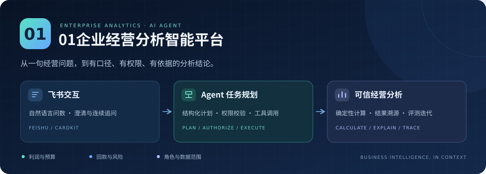
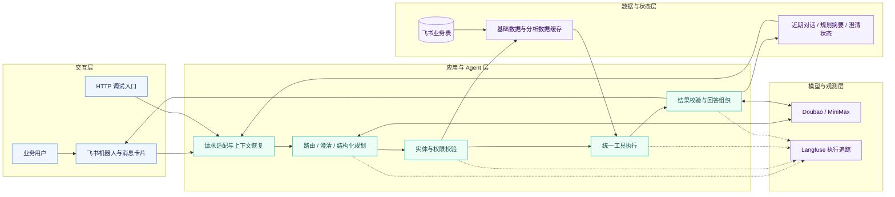
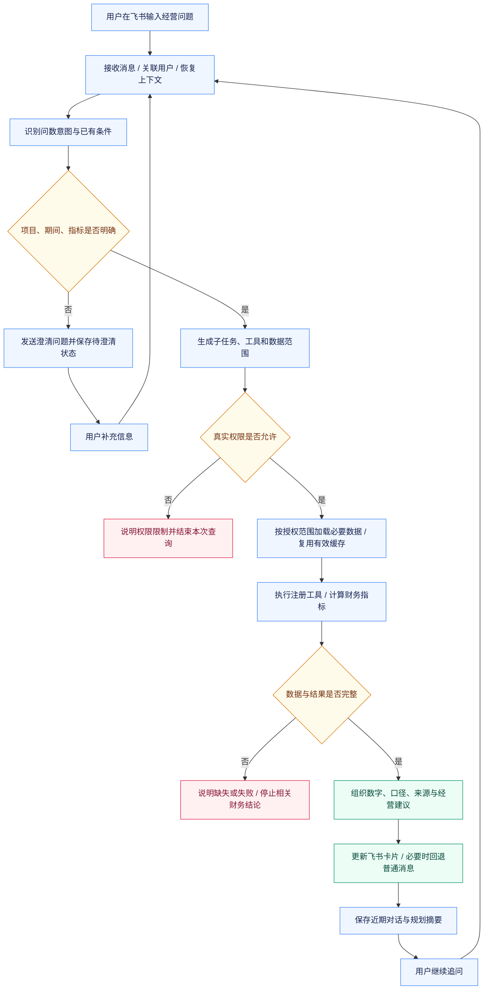
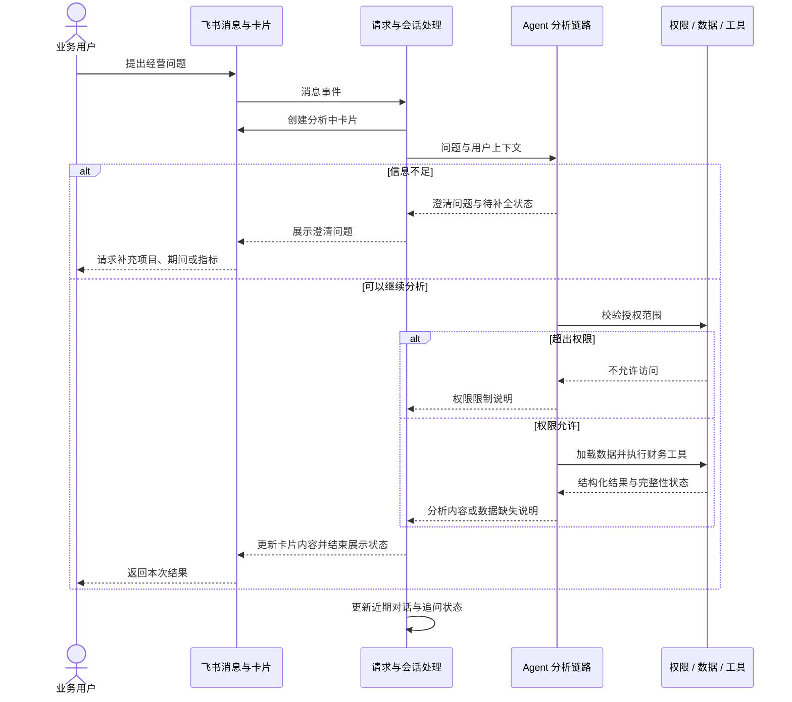

<div align="center">



# 01企业经营分析智能平台

**让经营问题，从自然语言走向可核对的分析结论。**

面向财务 BP、部门负责人及项目负责人的企业经营分析 Agent。

<p>
  
  
  
  
</p>

[项目概览](#overview) · [功能亮点](#features) · [系统架构](#architecture) · [完整流程](#workflow) · [快速开始](#quick-start) · [评测结果](#evaluation)

</div>

---

<a id="overview"></a>

## 📌 项目概览

企业经营分析经常需要人工跨多张飞书表格取数、核对财务口径、计算指标并确认访问权限。数据散落、统计口径不一致和分析过程重复，容易造成分析耗时长、结果难核对及风险发现滞后。

**01企业经营分析智能平台**围绕项目、预算、经营实际和回款数据，将自然语言问数、任务规划、权限校验、数据加载、确定性计算及结果归纳组织成一条完整链路。用户通过飞书提问，系统返回带有指标口径和数据依据的经营结论，并支持澄清与连续追问。

| 面向谁 | 关注什么 | 系统提供什么 |
| --- | --- | --- |
| 财务 BP（财务业务伙伴） | 预算执行、实际表现、财务口径 | 统一口径的预实对比与指标计算 |
| 部门负责人 | 部门经营表现、项目偏差与风险 | 授权范围内的项目汇总与经营分析 |
| 项目负责人 | 项目利润、成本、回款与逾期 | 项目级问数、明细解释与连续追问 |

> **项目说明与代码版本**：业务定位、核心职责及下文量化结果以[项目说明](企业经营分析智能平台.md)为准。项目说明采用 Python／FastAPI／Pydantic 技术口径；本目录现有参考实现为 Node.js／CommonJS。本文保留项目技术叙述，并在[技术栈](#stack)中注明映射；[快速开始](#quick-start)对应当前可见的 Node.js 代码。

### 导航

- [功能亮点与使用场景](#features)
- [系统架构与技术栈](#architecture)
- [飞书交互与完整处理流程](#workflow)
- [核心实现与源码导航](#implementation)
- [评测结果与统计口径](#evaluation)
- [目录结构](#structure)
- [快速开始与配置](#quick-start)
- [接口说明](#api)
- [测试与验证](#testing)
- [常见问题](#faq)
- [文档、贡献与许可证](#resources)

<a id="features"></a>

## ✨ 功能亮点

| 能力 | 解决的问题 | 实现思路 |
| --- | --- | --- |
| 🧭 受约束的 Agent 链路 | 复合问数容易漏掉意图或取错数据 | 路由、澄清、规划、权限、取数、执行与回答分层 |
| 🧩 结构化任务规划 | 自然语言难直接转换成可靠执行任务 | 专用提示词、少样本示例、结构化输出与失败回退 |
| 💬 多轮追问 | 用户需要反复说明项目、期间和指标 | 近期对话、规划摘要与待澄清状态协同管理 |
| 🔐 实体与权限治理 | 项目别名、部门歧义和跨范围查询 | 实体映射与角色、部门、项目范围逐层校验 |
| 🧮 确定性财务计算 | 模型直接计算容易产生口径或算术偏差 | 工具注册中心与统一执行器，以代码计算指标 |
| ⚡ 两级数据缓存 | 跨表读取延迟和外部接口波动 | 基础数据与分析数据缓存、按需加载、原子切换及失败保旧 |
| 🔎 可观测与评测迭代 | 多阶段错误难定位、优化效果难判断 | Langfuse 执行追踪、端到端评测与失败案例归因 |

### 可以问些什么？

```text
“海桥项目 8 月收入、利润和利润率是多少？与预算差在哪里？”
“星河一期目前回款多少，还有哪些款项逾期？”
“那人力成本超预算多少？”
“这几个项目里，哪个需要优先关注？”
```

系统会结合用户权限、项目实体、期间和已有上下文处理问题；存在歧义时先澄清，超出授权范围时说明限制，关键数据缺失时停止生成相关财务结论。

### 一个问数示例

> **以下为虚构数据示例，用于说明回答方式，不是线上运行截图或实际业务成果。**

**用户**：海桥项目 8 月利润是多少，为什么低于预算？

| 指标 | 同期预算 | 实际 | 偏差 |
| --- | ---: | ---: | ---: |
| 收入 | 120 万元 | 100 万元 | −20 万元 |
| 成本 | 84 万元 | 90 万元 | +6 万元 |
| 利润 | 36 万元 | 10 万元 | −26 万元 |
| 利润率 | 30% | 10% | −20 个百分点 |

**示例回答**：本期利润为 10 万元，低于预算 26 万元。从数值构成看，收入缺口为 20 万元，成本超支为 6 万元。建议进一步核对收入确认进度与成本明细；现有数据只能确定偏差构成，尚不能确认具体业务原因。

这条链路中，模型理解问题并组织解释，工具完成财务计算，权限和数据完整性由程序检查。

<a id="architecture"></a>

## 🏗️ 系统架构

交互端采用**飞书机器人与 CardKit 消息卡片**。飞书客户端承载聊天界面，应用侧负责接收消息、调用分析链路、更新卡片与保存追问状态。当前项目按这一交互入口介绍。



图中是按职责组织的逻辑架构；规划、权限解析及上下文处理在代码中存在多个分支，不能理解成所有请求都必须依次调用全部模块。可确定回答的场景也可以直接使用程序生成的结果。

<a id="stack"></a>

### 技术栈

**项目核心技术（8 项）：** Agent 任务规划、Prompt 工程、工具调用、FastAPI、Pydantic、飞书开放平台、RBAC、Langfuse。

| 层级 | 项目说明中的技术与职责 | 当前目录可见实现 |
| --- | --- | --- |
| 用户交互 | 飞书自然语言问数与结果回复 | 飞书 Node SDK、CardKit、Markdown |
| 后端服务 | Python／FastAPI 服务组织 | Node.js、CommonJS、内置 HTTP 服务 |
| 结构约束 | Pydantic 数据模型与校验 | JSON Schema、JSON 解析修复与业务规则 |
| 语言模型 | Doubao／MiniMax LLM（大语言模型） | 模型客户端、规划与回答供应方配置 |
| 任务规划 | Prompt 工程、少样本示例、结构化 Planner | `src/agent/planner.js` |
| 工具调用 | 工具注册中心与统一执行器 | `src/tools/`、`src/agent/executor.js` |
| 访问控制 | RBAC（基于角色的访问控制）与项目范围 | `src/permissions/` |
| 数据与缓存 | 飞书业务表、两级缓存与按需加载 | `src/memory/`、`src/cache/` |
| 观测与验证 | Langfuse、端到端评测 | Langfuse／OpenTelemetry、Jest、专项脚本 |

**版本边界：** FastAPI／Pydantic 是项目说明采用的技术口径，当前目录不包含已确认的对应 Python 主服务。启动命令、目录结构与源码链接均按当前参考实现给出，不将 JavaScript 模块描述成 Python 源码。

<a id="workflow"></a>

## 🔄 飞书交互与完整处理流程

### 从一句问题到经营结论



### 消息卡片如何与后端协作



CardKit 支持内容增量更新，创建卡片失败时可以回退普通消息。当前参考实现中，不同模型分支的返回方式有所区别：部分路径逐段返回，部分路径获得完整文本后再更新卡片。卡片显示效果不等于所有供应方都采用原生 Token 流式返回。

<a id="implementation"></a>

## 🧠 核心实现

### 1. 结构化 Planner：把问题变成执行计划

Planner（任务规划器）通过专用 Prompt（提示词）、Few-shot（少样本示例）和结构化输出要求，明确问题拆解、工具选择、数据依赖、期间与查询范围，并为必要的澄清保留状态。

以下为**简化计划示意**，省略完整 Schema 中的其他字段：

```json
{
  "action": "plan",
  "period": "2026-08",
  "question_decomposition": [
    "查询项目收入、利润及利润率",
    "比较同期预算与实际",
    "分析成本偏差"
  ],
  "tools_needed": [
    "finance.profitOverview",
    "finance.budgetComparison",
    "finance.costBreakdown"
  ],
  "query_scope": {
    "depts": ["示例部门"],
    "targetProjects": ["海桥项目"]
  }
}
```

结构化计划需要经过工具、范围和业务规则校验。异常处理包含解析修复、有限重试与回退分支；JSON 能解析不代表计划已经符合业务要求。

源码：[Planner 与计划结构](src/agent/planner.js#L103) · [结构化输出与重试](src/agent/planner.js#L1973)

### 2. 上下文：让追问延续正确的项目与期间

短期上下文包括近期对话、规划摘要及待澄清状态，用于理解“那回款呢”“第二个项目呢”等省略式问题。

- 项目说明口径：支持 **3 轮、30 分钟内**连续追问。
- 当前代码机制：保留最近 3 轮消息，超过 30 分钟无活动后过期。
- 规划摘要补充实体和结果集信息；追问仍需重新遵守真实权限范围。

源码：[对话存储](src/stores/conversation-store.js#L20) · [规划摘要](src/agent/planning-context-builder.js) · [待澄清状态](src/agent/pending-clarification.js)

### 3. 工具执行：计算结果可复算

工具注册表集中维护工具名称、描述、所需权限模块、依赖数据和处理函数；统一执行器根据计划分发调用，汇总结果、错误和耗时。

| 示例工具 | 职责 |
| --- | --- |
| `finance.profitOverview` | 利润总览与项目利润表现 |
| `finance.budgetComparison` | 同期预算与实际对比 |
| `finance.costBreakdown` | 成本科目拆解 |
| `finance.receivables` | 回款、未回款与逾期分析 |

财务指标交由程序计算，模型据此组织解释。复算需要使用相同数据、范围、口径和截止时间；关键数据或计算结果不完整时，主链路会阻止相关完整财务结论继续生成。

源码：[工具注册表](src/tools/tool-registry.js#L31) · [统一执行器](src/agent/executor.js#L30) · [财务工具](src/tools/finance-tools.js) · [完整性检查](src/agent/pipeline-core.js#L192)

### 4. 权限与实体：查对项目，也控制数据范围

围绕项目别名、部门歧义和跨范围查询，将实体识别与“角色→部门→项目”访问范围结合，在规划、工具执行前及数据过滤阶段落实校验。

| 边界 | 检查内容 |
| --- | --- |
| 规划输入 | 向规划器提供用户可用的工具目录 |
| 执行前 | 检查工具及显式部门、项目请求 |
| 数据加载 | 根据真实范围过滤业务记录 |
| 结果返回 | 拒绝越权查询，说明实际分析范围 |

模型提出的查询范围代表“想查什么”，后端解析出的访问范围决定“能查什么”。

源码：[实体索引](src/agent/entity-index.js) · [权限解析](src/permissions/permission-manager.js) · [执行前策略](src/agent/pipeline.js#L1613) · [数据过滤](src/memory/loader.js#L919)

### 5. 两级缓存：减少重复取数

项目说明将缓存划分为基础数据与分析数据两级。当前参考实现中，可见表级数据镜像，以及按用户／范围复用的已加载业务数据集合。

```text
飞书业务表
    ↓ 同步与必要数据校验
基础数据缓存：表级快照
    ↓ 选择必要数据并应用访问范围
分析数据缓存：已加载的数据集合
    ↓
工具计算与回答生成
```

刷新成功后切换生效缓存；后台刷新失败时保留旧版本。原子切换指缓存引用的整体替换，不代表外部多张飞书表具备同一时点的数据库事务快照。缓存还需结合时效、权限与数据完整性使用。

源码：[缓存构建与切换](src/cache/local-cache-syncer.js#L180) · [失败保旧](src/cache/local-cache-syncer.js#L232) · [分析数据缓存](src/memory/cache.js) · [按需加载](src/memory/loader.js#L192)

### 6. 可观测与评测：把错误定位到具体阶段

Langfuse 记录 Trace（一次请求的执行轨迹）和 Span（轨迹中的子阶段），帮助区分规划选错工具、范围错误、数据缺失、工具失败及回答偏离事实等问题。

端到端评测结合权限角色、期望工具、数据范围和财务真值，依据失败案例调整提示词及路由规则。追踪说明过程，评测判断结果，两者配合形成迭代依据。

源码：[Langfuse 封装](src/utils/langfuse-client.js) · [工具级追踪](src/agent/executor.js#L57) · [测试目录](tests/) · [专项脚本索引](scripts/README.md)

<a id="evaluation"></a>

## 📊 评测结果

> 以下为[项目说明](企业经营分析智能平台.md)记录的阶段性结果，沿用简历口径。它们不是本文档编写时重新运行的结果，也不等同于持续线上服务指标。

| 评测方向 | 样本或数据范围 | 项目记录结果 |
| --- | --- | --- |
| 端到端问数 | 10 个权限角色、100 条用例 | **94/100 通过** |
| 执行耗时 | 上述端到端评测口径 | **平均 29.6 秒，无超时** |
| 权限回归 | 16 条越权、敏感数据与模糊指代样本 | **15/16 通过，策略符合率 93.8%** |
| 数据访问结果 | 上述权限回归样本 | **未授权数据输出 0** |
| 缓存验收 | 25 张核心表、19,166 行数据、50 条场景 | **累计本地命中 846 次** |
| 缓存稳定性 | 上述缓存测试范围 | **远端读取违规、同步错误及超时均为 0** |
| 用户反馈 | 两轮飞书问卷 | **76.9%（30/39）→91.3%（42/46）** |

<details>
<summary><strong>查看统计口径与解释边界</strong></summary>

- `94/100` 是既定用例与判定规则下的通过结果，不能直接外推为所有用户问题的准确率。
- `15/16` 表示权限策略符合情况；未授权输出为零与存在一条策略不符合可以同时成立，具体失败原因需要对应报告解释。
- `846` 是缓存命中次数；缺少查询总次数时，不能据此计算命中率。“远端读取违规为零”也不等于所有远端调用为零。
- 两轮问卷样本数不同，满意度变化用于描述观察到的反馈，不单独证明某项改动的因果效果。
- 平均耗时、超时阈值及失败样本纳入方式以原始评测定义为准。复现实验需要相应数据版本、权限配置和标注。

</details>

<a id="structure"></a>

## 🗂️ 目录结构

```text
.
├── README.md                     # 项目介绍
├── bot.js                        # 当前服务统一启动入口
├── server.js                     # 兼容启动入口
├── config.js                     # 配置、模型选择与业务表映射
├── package.json                  # 当前 Node.js 依赖与命令
├── src/
│   ├── app/
│   │   ├── feishu/                # 飞书消息适配与交互处理
│   │   └── http/                  # HTTP 接口与回调
│   ├── agent/                    # 规划、上下文、澄清与执行链路
│   ├── clients/                  # 飞书、模型与卡片客户端
│   ├── permissions/              # 角色、部门、项目访问策略
│   ├── tools/                    # 工具注册与业务计算
│   ├── engines/                  # 指标、风险等计算逻辑
│   ├── memory/                   # 业务数据加载、过滤与缓存
│   ├── cache/                    # 基础表镜像与同步
│   ├── stores/                   # 对话等状态存储
│   ├── services/                 # 业务服务及定时任务
│   └── utils/                    # 字段映射、追踪等工具
├── tests/                        # 单元与行为回归测试
├── scripts/                      # E2E、审计与专项验证入口
├── docs/assets/                   # README 视觉素材
├── data-platform-web/            # 授权回调辅助模块
├── 企业经营分析智能平台.md         # 项目概述与量化结果来源
└── 基础概念.md                    # 业务案例、财务及技术概念
```

目录中的 `memory` 也用于表示“已加载业务数据集合”，并不都指聊天记忆。`data-platform-web` 是授权回调辅助模块，交互主入口仍是飞书。

<a id="quick-start"></a>

## 🚀 快速开始

本节用于运行**当前目录的 Node.js 参考实现**。业务能力依赖飞书应用、模型访问凭证和匹配的业务表结构；仓库不附带可公开使用的企业财务数据及访问凭证。

### 1. 准备环境

| 依赖 | 要求 |
| --- | --- |
| Node.js 与 npm | 可使用 Node.js 22；当前锁定的 Langfuse 依赖要求 Node.js ≥20，仓库尚未固定统一运行时版本 |
| 飞书应用 | 配置机器人、消息事件及所需的数据与卡片权限 |
| 业务数据 | 准备项目、预算、实际、回款、员工与权限等数据，并核对字段映射 |
| 模型服务 | 配置可用的 Doubao／MiniMax 服务访问方式及模型标识 |
| Langfuse | 可选，用于执行链路观测 |

### 2. 获取代码并安装依赖

将下面的仓库地址替换为实际地址；已在本地仓库中时，直接安装依赖即可。

```bash
git clone https://github.com/YOUR_ACCOUNT/YOUR_REPOSITORY.git 01-enterprise-analytics
cd 01-enterprise-analytics
npm ci
```

### 3. 配置本地环境

在仓库根目录创建本地 `.env`，以下仅展示占位配置，按实际环境填写：

```dotenv
# 飞书应用与业务数据空间
FEISHU_APP_ID=your_feishu_app_id
FEISHU_APP_SECRET=your_feishu_app_secret
BITABLE_APP_TOKEN=your_bitable_app_token

# Doubao / 火山方舟：使用账号可访问的模型或端点标识
ARK_API_KEY=your_ark_api_key
ARK_MODEL=your_ark_model_or_endpoint
ARK_PLAN_MODEL=your_ark_plan_model_or_endpoint
ARK_ANSWER_MODEL=your_ark_answer_model_or_endpoint
PLAN_PROVIDER=ark
ANSWER_PROVIDER=ark

# HTTP 服务
PORT=3000

# 本地调试：定时任务采用演练模式，不主动推送报告
SCHEDULED_PUSH_SCHEDULE_MODE=dryRun
SCHEDULED_PUSH_ENABLED=false

# 业务表映射就绪前，可先关闭启动时的全量镜像
LOCAL_MEMORY_CACHE_ENABLED=false

# 尚未配置观测服务时关闭追踪导出
LANGFUSE_DISABLED=true
```

**业务表配置是必需的适配步骤。** 按 [config.js](config.js) 和 [字段映射](src/utils/field-mapping.js) 核对业务表及字段，不能仅替换模型密钥后就假定财务问数可用。预算、实际、回款和权限数据必须属于同一套可解释的业务口径。

<details>
<summary><strong>MiniMax、Langfuse 与缓存的可选配置</strong></summary>

| 配置项 | 用途 |
| --- | --- |
| `MINIMAX_API_KEY` | MiniMax 访问凭证 |
| `MINIMAX_MODEL` / `MINIMAX_ANSWER_MODEL` | 对应调用阶段的模型标识 |
| `PLAN_PROVIDER` / `ANSWER_PROVIDER` | 规划与回答使用 `ark` 或 `minimax` |
| `LANGFUSE_PUBLIC_KEY` / `LANGFUSE_SECRET_KEY` / `LANGFUSE_BASE_URL` | Langfuse 连接配置 |
| `LANGFUSE_DISABLED=false` | 配置完成后启用追踪 |
| `LOCAL_MEMORY_CACHE_ENABLED=true` | 业务表准备完成后启用基础数据镜像 |
| `LOCAL_MEMORY_CACHE_REFRESH_INTERVAL_MS` | 基础数据缓存刷新间隔 |

参考实现存在 MiniMax 失败后回退 Ark 的路径。采用该回退方式时，需要同时准备可用的 Ark 配置；具体模型版本以部署配置为准。

</details>

**定时任务说明：** 当前启动入口会注册业务定时任务，示例使用 `dryRun` 模式。`SCHEDULED_PUSH_ENABLED=false` 用于部分管理接口开关，不能将其视为已经覆盖全部调度路径的全局停用开关。调试时使用测试应用和测试数据。

### 4. 启动并检查服务

完成飞书、模型与数据配置后执行：

```bash
npm start
```

在另一个终端检查：

```bash
curl http://127.0.0.1:3000/api/health
```

健康接口反映进程和部分组件状态。接口可访问不代表所有模型、业务表和权限配置都已经通过端到端验证。

### 5. 在飞书中提问

向已配置的机器人发送一个有明确项目和期间的问题，观察“分析中→澄清或执行→最终回复”的过程，再尝试省略式追问。建议先使用可独立核对的测试数据和已授权账号验证。

<a id="api"></a>

## 🔌 接口说明

以下路径来自当前参考实现的 [HTTP 路由](src/app/http/router.js)。

| 方法 | 路径 | 用途 |
| --- | --- | --- |
| `GET` | `/api/health` | 服务状态、基础缓存与会话统计 |
| `POST` | `/api/chat` | 非流式问数接口 |
| `POST` | `/api/webhook` | 飞书事件兼容入口 |
| `GET` | `/api/oauth/callback` | 授权回调 |

### 问数请求示例

下面是本地调试示例。将演示用户替换为测试环境中能正确解析权限的用户标识；示例不包含真实企业账号或数据。

```bash
curl -X POST http://127.0.0.1:3000/api/chat \
  -H 'Content-Type: application/json' \
  -d '{
    "user_id": "demo_finance_user",
    "message": "海桥项目2026年8月的利润和预算差异是多少？"
  }'
```

| 请求字段 | 必填 | 说明 |
| --- | --- | --- |
| `user_id` | 是 | 用户关联标识，用于后续用户与权限处理 |
| `message` | 是 | 用户问题 |
| `conversationHistory` | 否 | 近期对话 |
| `plannerConversationHistory` | 否 | 规划阶段使用的历史上下文 |
| `planningContext` | 否 | 规划摘要 |

当前兼容返回结构主要包含 `reply`、`usage`、`memory_update`，失败时可能附带 `error`，详见 [request-adapter.js](src/agent/request-adapter.js#L15)。业务拒答和澄清也可能通过 `reply` 返回，不能只以 HTTP 200 判断任务成功。

此 HTTP 入口接收调用方传入的用户相关字段，应在可信调试环境使用；若用于公网服务，需要另行落实请求身份认证与用户绑定，不能将请求体中的身份声明当成登录认证。

<a id="testing"></a>

## 🧪 测试与验证

### 测试入口

项目通过 `npm test` 调用 Jest。可先指定链路核心和工具参数测试：

```bash
npm test -- --runInBand tests/pipeline-core.test.js tests/tool-param-resolver.test.js
```

需要运行更广范围时：

```bash
npm test -- --runInBand
```

测试目录同时包含历史验证脚本与不同环境依赖的用例，完整测试集不保证在未配置外部依赖的环境下全部通过。以上是执行入口，不表示本次文档更新已经通过这些测试。

### 验证重点

| 方向 | 代表性测试或入口 | 核对内容 |
| --- | --- | --- |
| Agent 链路 | [pipeline-core.test.js](tests/pipeline-core.test.js) | 澄清、范围传递与失败处理 |
| 工具参数 | [tool-param-resolver.test.js](tests/tool-param-resolver.test.js) | 指标、排序与参数解析 |
| 权限范围 | [finance-access-policy.test.js](tests/finance-access-policy.test.js) | 财务访问策略 |
| 项目实体 | [entity-index.test.js](tests/entity-index.test.js) | 实体候选与歧义处理 |
| 缓存行为 | [local-memory-cache.test.js](tests/local-memory-cache.test.js) | 本地读取、同步及异常路径 |
| 缓存端到端 | [缓存 E2E 脚本](scripts/e2e/e2e-local-cache-finance-50.js) | 真实链路的数据与读取行为 |

更多入口见 [scripts/README.md](scripts/README.md)。真实业务 E2E、审计及推送脚本需要各自的凭证、数据和运行条件，不能把单元测试结果直接当成简历中阶段性评测结果的复现。

<a id="faq"></a>

## 💡 常见问题

<details>
<summary><strong>项目是否有前端？</strong></summary>

交互端使用飞书机器人和 CardKit 消息卡片，界面由飞书客户端承载，应用侧实现消息适配、卡片内容更新和结果反馈。当前介绍以该入口为准；`data-platform-web` 主要用于授权回调。

</details>

<details>
<summary><strong>AI 具体负责什么？</strong></summary>

Doubao／MiniMax 提供语言理解与生成能力；规划阶段拆解问题、选择工具和数据范围，回答阶段基于工具结果归纳结论。程序负责权限、数据处理及财务计算。提示词、少样本示例和结构化约束用于改善计划质量。

</details>

<details>
<summary><strong>为什么使用两级缓存？</strong></summary>

基础数据缓存减少跨表远程读取，分析数据缓存复用已经加载的数据集合。两者配合按需加载和刷新机制，降低重复读取。缓存存在并不意味着数据始终最新，仍需结合截止时间与授权范围使用。

</details>

<details>
<summary><strong>“3 轮、30 分钟”是只能问三次吗？</strong></summary>

当前代码保留最近 3 轮消息，并在 30 分钟无活动后过期，属于短期上下文窗口；用户可以继续提问，但更早的信息可能已不在当前上下文中。

</details>

<details>
<summary><strong>没有企业数据能直接复现评测结果吗？</strong></summary>

可以阅读代码与运行条件满足的测试，但业务评测依赖特定数据、权限、标注和统计口径。公共目录中的源码不等于已经提供了完整可公开复现的数据集。

</details>

<a id="resources"></a>

## 📚 文档与贡献

| 文档 | 内容 |
| --- | --- |
| [项目说明](企业经营分析智能平台.md) | 背景、职责与阶段性成果 |
| [基础概念](基础概念.md) | 完整案例、财务口径与技术术语 |
| [脚本索引](scripts/README.md) | 专项验证、E2E 与运维入口 |
| [仓库协作约定](AGENTS.md) | 代码约定与修改流程 |

如需反馈问题，可提供脱敏后的问题描述、预期与实际行为、相关阶段及最小复现方式。新增工具或修改规划、权限和财务口径时，建议同时补充相应行为验证，并遵循仓库协作约定。

README 使用仓库相对路径、SVG 封面和 Mermaid 图表，适合在 GitHub 上浏览。格式说明可参考 [GitHub README 文档](https://docs.github.com/en/repositories/managing-your-repositorys-settings-and-features/customizing-your-repository/about-readmes)与 [GitHub 图表文档](https://docs.github.com/en/get-started/writing-on-github/working-with-advanced-formatting/creating-diagrams)。

### 许可证

当前 `package.json` 的许可证字段为 `ISC`，仓库中尚未发现独立许可证文件。项目授权以权利人确认并提供的许可证文件为准；依赖组件遵循各自许可证。

---

<div align="center">

**01企业经营分析智能平台**

飞书交互 · 任务规划 · 权限取数 · 可信计算 · 可追踪分析

[返回顶部](#01企业经营分析智能平台)

</div>
